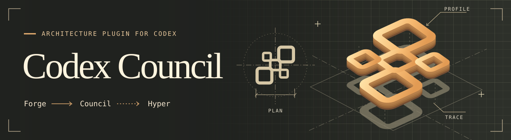

# 

Codex Council is a plugin for designing and building software with Codex. Start with a feature you want or a proposal you want challenged. The agents ask about decisions that change the design, record disagreements, and turn the agreed scope into code with acceptance tests.

[English handbook](https://ercoledevs.github.io/codex-council/) · [Manuale italiano](https://ercoledevs.github.io/codex-council/it/) · [Releases](https://github.com/ercoledevs/codex-council/releases) · [MIT license](LICENSE)

## Quickstart

Install the plugin, then reload Codex. Use `--project` in place of `--global` to install it for a single repository.

```bash
npx codex-marketplace add ercoledevs/codex-council --plugin --global -y
```

Open the repository you want to work on and paste this into a Codex chat.

```text
Use $codex-council:codex-mind at mid effort to design a recoverable job queue.
Ask me what should happen if a worker stops after writing its result but before
acknowledging the job. Design and review the first working slice.
```

Mind checks the repository, groups open questions and shows the estimated cost before dispatching specialists. In this example, the answer about duplicate writes shapes both the storage contract and the restart test. You get a proposal, a review and a verdict of `build`, `revise` or `stop`. If you also authorize implementation, a blocker-free `build` can proceed to Hyper.

<details>
<summary>Update an installation or use a local checkout</summary>

To update, repeat the install command with the same scope and reload Codex. For a manual installation, clone this repository into your local plugin directory and add an entry to your local marketplace. Set the source path to the checkout location used by that marketplace.

```json
{
  "name": "codex-council",
  "source": { "source": "local", "path": "./plugins/codex-council" },
  "policy": { "installation": "AVAILABLE", "authentication": "ON_INSTALL" },
  "category": "Productivity"
}
```

Reload Codex after registering the plugin.

</details>

## Choose a workflow

Included in the current release are Council, Forge, Mind, Hyper and Alters. Invoke a skill directly when you already know which step you need.

| Start here | When you have… | What you get |
| --- | --- | --- |
| [Mind](https://ercoledevs.github.io/codex-council/mind.html) | An idea with important decisions still open | A guided interview, a proposal and a review in one conversation |
| [Forge](https://ercoledevs.github.io/codex-council/forge.html) | A goal and constraints, but several plausible designs | A proposal with boundaries, failure modes, a first working slice and unresolved trade-offs |
| [Council](https://ercoledevs.github.io/codex-council/wiki.html#method) | A design, migration or change ready for scrutiny | A verdict with blockers, dissent and the checks needed to resolve them |
| [Hyper](#codex-hyper) | An approved change with acceptance criteria | A patch, the checks that ran and remaining risks |
| [Alters](https://ercoledevs.github.io/codex-council/alters.html) | A question a specialist should raise in future reviews | A preview of the role adjustment and the option to save it locally |

### Pick an effort

Use **`simple`** for a reversible choice, **`mid`** for a typical architecture decision, and **`ultra`** for a full review. An ordinary Council run starts with one member at `simple`, three members and one reviewer at `mid`, or six members and five reviewers at `ultra`. Hard risks can raise coverage. The estimate shows the actual panel before you accept it.

From the plugin checkout, preview the run locally.

```bash
python3 scripts/codex_council.py estimate --topic "Recoverable job queue" --effort mid
```

Add `--details` for the estimate breakdown. To resume a longer design conversation, save its decisions in a local brief and pass it through to estimation and session creation. [Local brief walkthrough](https://ercoledevs.github.io/codex-council/architecture.html#local)

## Codex Hyper

Hyper keeps one writer for the repository. For a bounded change it can work solo. For changes that need independent investigation, Relay adds read-only explorers and a fresh verifier. A handoff from Mind always uses Relay. Hyper reports each required check as `PASS`, `FAIL` or `UNKNOWN`. [Implementation protocol](skills/codex-hyper/SKILL.md)

**A recorded run.** In a Node.js scheduler, Hyper added bounded concurrency, retries and cancellation while preserving result order. The retained patch passed all 13 tests on replay. The record includes the patch, checks and gaps in workflow provenance. [Inspect or replay the scheduler case](docs/evidence/2026-07-23-node-scheduler/README.md)

## Documentation

The wiki includes 30
paste-ready prompt templates for design reviews, migrations and implementation work. [Browse the prompt cookbook](https://ercoledevs.github.io/codex-council/wiki.html#cookbook)

| I want to… | Read |
| --- | --- |
| Design a feature from an empty repository | [Architecture guide and three worked scenarios](https://ercoledevs.github.io/codex-council/architecture.html#cases) |
| Install, update or inspect a session | [Installation](https://ercoledevs.github.io/codex-council/usage.html#install) and [CLI reference](https://ercoledevs.github.io/codex-council/wiki.html#cli) |
| Review a frontend change against browser evidence | [Frontend review](https://ercoledevs.github.io/codex-council/wiki.html#frontend) |
| Replay a completed session or inspect its decision history | [Experimental Decision Runtime](https://ercoledevs.github.io/codex-council/runtime.html) |
| Understand the evidence behind the method | [Research notes](https://ercoledevs.github.io/codex-council/architecture.html#research) and [limits](https://ercoledevs.github.io/codex-council/limits.html) |

Session artifacts live in plugin-local `.codex-council/` by default. They can contain prompts and decisions. Token and cost reports are local forecasts. Decision Runtime is opt-in and keeps its projections separate from the authoritative session record.

## Development

Run the tests from a checkout. The second command validates a clean distribution.

```bash
python3 -m unittest discover -s tests -v
python3 scripts/codex_council.py validate --plugin-root . --strict
```

[Report an issue](https://github.com/ercoledevs/codex-council/issues) · [Changelog](CHANGELOG.md) · [Source and method credits](PROVENANCE.md)

## Why I built it

I built Codex Council because one Codex pass can blur the line between judging a design and proving that it works. I wanted a way to inspect each step and see which checks actually ran.

I maintain the project independently. If it helps your work, you can [support development via PayPal](https://www.paypal.me/SalvatoreErcole117).
